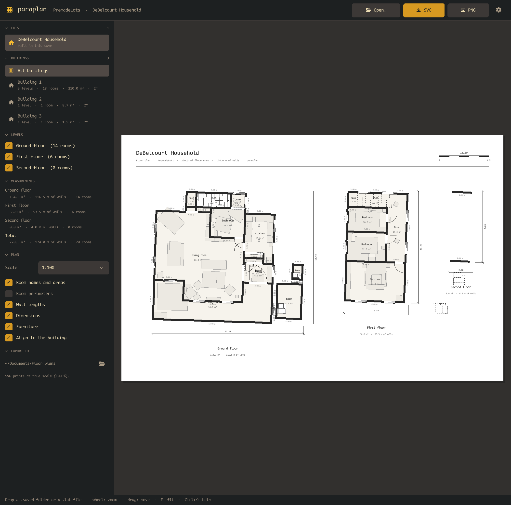

<p align="center">
  
</p>

<h1 align="center">paraplan</h1>
<p align="center"><b>Paralives save → floor plans</b> · real, printable plans of the houses in your game</p>

<p align="center">
  
</p>

paraplan reads a **Paralives** save and draws its buildings as proper architectural floor plans: walls at their
real thickness, doors with swings, windows, arches, stairs (and the stair opening on the level above), furniture,
room names with areas, overall dimensions, a title block and a scale bar. All levels of a building sit side by
side on one sheet.

- **SVG** at true paper size (1:50, 1:100 or 1:200): print at 100 % and measure with a ruler.
- **PNG** at 300 dpi of the same sheet (max 8000 px, 2× supersampled).

**Press `Ctrl + K`** for all keyboard shortcuts and the About page.

## Requirements to run

- Linux x86_64 with a **Wayland** session (no X11 / XWayland)
- OpenGL 3.3 graphics driver (Mesa or your GPU vendor's)
- `libwayland-client`, `libwayland-cursor`, `libwayland-egl`, `libxkbcommon`, `libEGL`: already present on any Wayland desktop
- Paralives (Steam, through Proton) for the saves. paraplan finds them on its own; a copied `.saved` folder or a
  single `.lot` file works too.

## Requirements to build

- [C3](https://c3-lang.org) compiler `c3c` **0.8.x**
- a C compiler for linking (`gcc` or `clang`)
- `git`, `python3`

raylib and the UI font come with the [bmu](https://github.com/foelkdavid/bmu) submodule; nothing else to install.

## Download, build, install

```sh
git clone --recurse-submodules https://github.com/foelkdavid/paraplan.git
cd paraplan
c3c build install --trust=full
```

This installs `~/.local/bin/paraplan`, a desktop launcher and the icon (no sudo). Make sure `~/.local/bin` is on
your `PATH`.

```sh
git pull --recurse-submodules && c3c build install --trust=full   # update
c3c build uninstall --trust=full                                   # uninstall
```

## Use

```sh
paraplan                              # opens the last save (or the first one Steam has)
paraplan "path/to/Save File 1.saved"  # a save folder
paraplan some.lot                     # a single lot (e.g. the game's Main.mod/PremadeLots/*.lot)
paraplan --export DIR SAVE            # every building as SVG + PNG into DIR, then quit
```

Pick a building in the sidebar, choose levels, scale and what to show, then export with the SVG / PNG buttons
(Ctrl+E / Ctrl+P). Drop a `.saved` folder or `.lot` file on the window to open it. Click a room to rename it
(names are kept in `~/.config/paraplan/rooms.ini`); otherwise rooms are named from the furniture in them
(Bathroom, Bedroom, Kitchen, …).

Saves are found through Steam's library folders (Proton prefix of app 1118520,
`…/AppData/LocalLow/Paralives/Paralives/MySavedGames.mod/*.saved`). Lots the player never touched are proxies of
the game's premade lots; their geometry is read from the game install
(`steamapps/common/Paralives/Main.mod/PremadeLots`). Item names (door / window / stairs / furniture) come from the
install's `Main.mod/Settings/Items.setting`; without the install a size-based guess is used.

paraplan only **reads** the save and the game install; it never changes them.

## Limits

The save format is undocumented; paraplan reads what the game writes today (JSON lots) and may need updates when
the game changes it. Door swing side and the stairs' up direction are not stored in a way paraplan understands
yet, so they follow the item's orientation. Level names (ground floor / basement) are guessed from wall heights.

## Built with

| | used for | license |
|---|---|---|
| [C3](https://c3-lang.org) ([c3c](https://github.com/c3lang/c3c)) | language, compiler, standard library | [compiler LGPL-3.0, standard library MIT](https://github.com/c3lang/c3c#licensing) |
| [bmu](https://github.com/foelkdavid/bmu) | UI toolkit (submodule) | not chosen yet |
| [raylib](https://www.raylib.com) 6.0 | window, input, drawing (static) | [zlib](licenses/RAYLIB-LICENSE.txt) |
| [GLFW](https://www.glfw.org) 3.4 | Wayland window backend, inside raylib | [zlib](https://www.glfw.org/license.html) |
| [CodeNewRoman Nerd Font Propo](https://www.nerdfonts.com/font-downloads) | embedded UI font ([Code New Roman](https://github.com/ryanoasis/nerd-fonts/tree/master/patched-fonts/CodeNewRoman) by Sam Radian + [Nerd Fonts](https://github.com/ryanoasis/nerd-fonts) icons) | [SIL OFL 1.1](licenses/FONT-OFL.txt) |

The font and raylib notices are in [`licenses/`](licenses/) and are installed with the app.

paraplan is an unofficial fan tool, not affiliated with or endorsed by Paralives Studio. Paralives is a trademark
of its owner.
